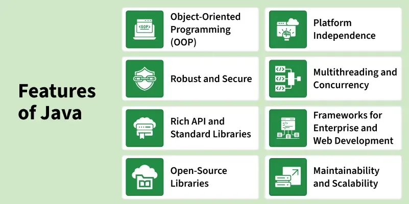

# 2. What are the top Java Features?

Java is one the most famous and most used language in the real world, there are many features in Java that makes it better than any other language some of them are mentioned below:

Features of Java

- **Simple**: Java is quite simple to understand and the syntax
- **Platform Independent:** Java is platform independent means we can run the same program in any software and hardware and will get the same result.
- **Interpreted**: Java is interpreted as well as a compiler-based language.
- **Robust**: features like Garbage collection, exception handling, etc that make the language robust.
- **Object-Oriented**: Java is an object-oriented language that supports the concepts of class,  objects, four pillars of OOPS, etc.
- **Secured**: As we can directly share an application with the user without sharing the actual program makes Java a secure language.
- **High Performance:**  faster than other traditional interpreted programming languages.
- **Dynamic**: supports dynamic loading of classes and interfaces.
- **Distributed**: feature of Java makes us able to access files by calling the methods from any machine connected.
- **Multithreaded**: deal with multiple tasks at once by defining multiple threads
- **Architecture Neutral**: it is not dependent on the architecture.

---

[← Back to Easy index](README.md) · Source: [GeeksforGeeks](https://www.geeksforgeeks.org/java/java-interview-questions/#2-what-are-the-top-java-features)
