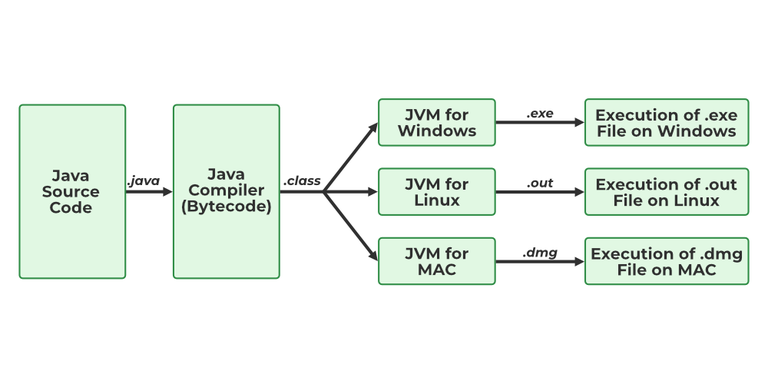

# 3. What is JVM?

The [Java Virtual Machine (JVM)](https://www.geeksforgeeks.org/java/how-jvm-works-jvm-architecture/) is a virtual machine that executes Java bytecode and provides a runtime environment for Java applications. It acts as a bridge between the Java program and the underlying operating system.

- JVM loads, verifies, and executes Java bytecode (.class files).
- It provides platform independence by allowing the same bytecode to run on different operating systems.
- JVM also manages memory, garbage collection, and runtime execution.

JVM

---

[← Back to Easy index](README.md) · Source: [GeeksforGeeks](https://www.geeksforgeeks.org/java/java-interview-questions/#3-what-is-jvm)
