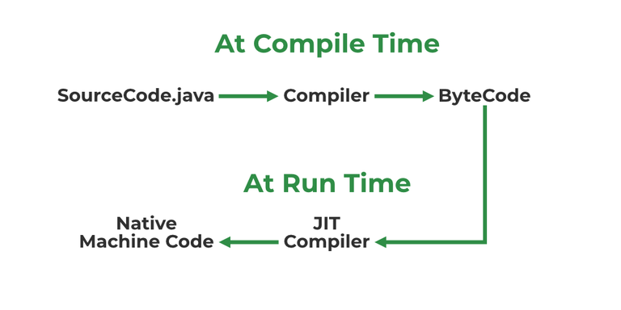

# 4. What is JIT?

[JIT stands for (Just-in-Time)](https://www.geeksforgeeks.org/java/just-in-time-compiler/) compiler is a part of JRE(Java Runtime Environment), it is used for better performance of the Java applications during run-time. The use of JIT is mentioned in step by step process mentioned below:

JIT

- Source code is compiled with **javac** to form bytecode
- Bytecode is further passed on to JVM
- JIT is a part of JVM, JIT is responsible for compiling bytecode into native machine code at run time.
- The JIT compiler is enabled throughout, while it gets activated when a method is invoked. For a compiled method, the JVM directly calls the compiled code, instead of interpreting it.
- As JVM calls the compiled code that increases the performance and speed of the execution.

---

[← Back to Easy index](README.md) · Source: [GeeksforGeeks](https://www.geeksforgeeks.org/java/java-interview-questions/#4-what-is-jit)
