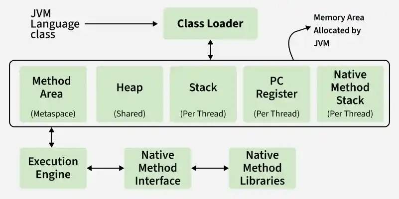

# 5. What are Memory storages available with JVM?

JVM consists of a few [memory storages](https://www.geeksforgeeks.org/java/how-many-types-of-memory-areas-are-allocated-by-jvm/) as mentioned below:

Memory storages

- **Class(Method) Area:** stores class-level data of every class such as the runtime constant pool, field, and method data, and the code for methods.
- **Heap:** Objects are created or objects are stored. It is used to allocate memory to objects during run time.
- **Stack:** stores data and partial results which will be needed while returning value for method and performing dynamic linking
- **Program Counter Register:** stores the address of the Java virtual machine instruction currently being executed.
- **Native Method Stack:** stores all the native methods used in the application.

---

[← Back to Easy index](README.md) · Source: [GeeksforGeeks](https://www.geeksforgeeks.org/java/java-interview-questions/#5-what-are-memory-storages-available-with-jvm)
