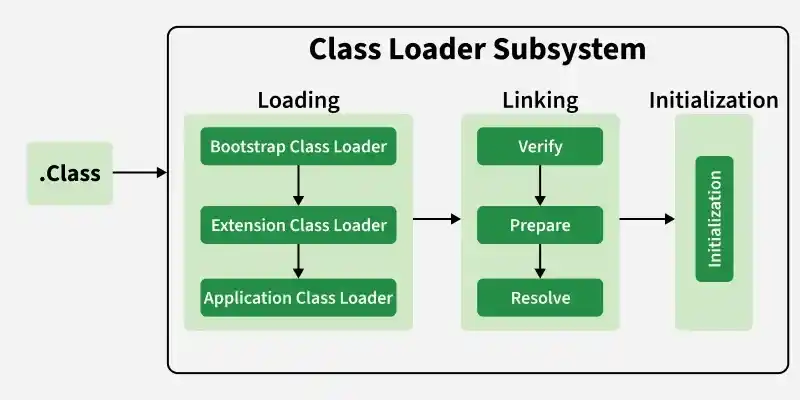

# 6. What is a classloader?

[Classloader](https://www.geeksforgeeks.org/java/classloader-in-java/) is a JVM component responsible for loading Java classes into memory at runtime. It loads classes only when they are needed, improving memory efficiency and application performance.

- Loads .class files into JVM memory dynamically.
- Supports dynamic class loading during program execution.

classloader

---

[← Back to Easy index](README.md) · Source: [GeeksforGeeks](https://www.geeksforgeeks.org/java/java-interview-questions/#6-what-is-a-classloader)
