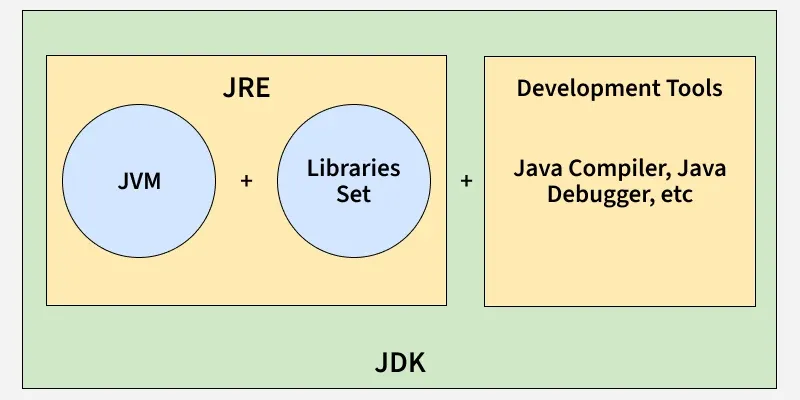

# 7. Difference between JVM, JRE, and JDK.

[JVM, JRE, and JDK](https://www.geeksforgeeks.org/java/differences-jdk-jre-jvm/) are the three main components of the Java platform. Together, they provide the environment required to develop, compile, and run Java applications.

- **JVM (Java Virtual Machine):** Executes Java bytecode and provides platform independence.
- **JRE (Java Runtime Environment):** Contains JVM and libraries required to run Java applications.
- **JDK (Java Development Kit):** Contains JRE along with development tools such as the compiler (javac) and debugger.

---

[← Back to Easy index](README.md) · Source: [GeeksforGeeks](https://www.geeksforgeeks.org/java/java-interview-questions/#7-difference-between-jvm-jre-and-jdk)
