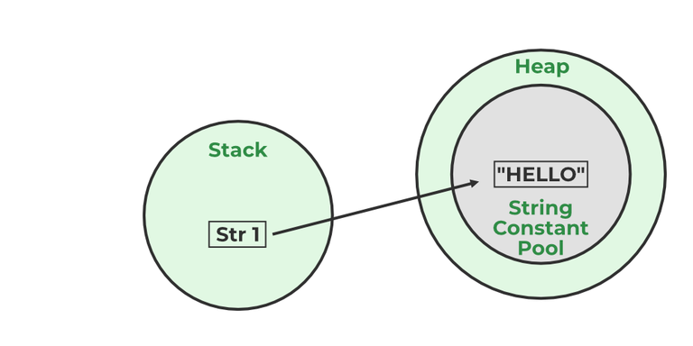

# 10. What is Java String Pool?

The Java String Pool (JSP) is a special memory area inside the heap where Java stores string literals. It helps save memory by reusing existing string objects instead of creating duplicate ones.

- String literals are stored in the String Pool to optimize memory usage.
- If a string already exists in the pool, Java returns the existing reference instead of creating a new object.

Java String Pool

**Example:**

> String str1="Hello";
> // "Hello" will be stored in String Pool
> // str1 will be stored in stack memory

---

[← Back to Easy index](README.md) · Source: [GeeksforGeeks](https://www.geeksforgeeks.org/java/java-interview-questions/#10-what-is-java-string-pool)
