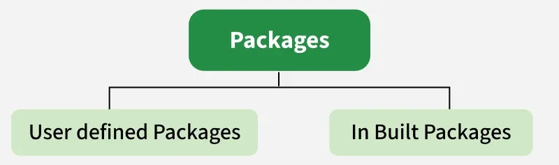

# 15. How many types of packages are there in Java?

There are two types of packages in Java

- User-defined packages
- Build In packages

---

[← Back to Easy index](README.md) · Source: [GeeksforGeeks](https://www.geeksforgeeks.org/java/java-interview-questions/#15-how-many-types-of-packages-are-there-in-java)
