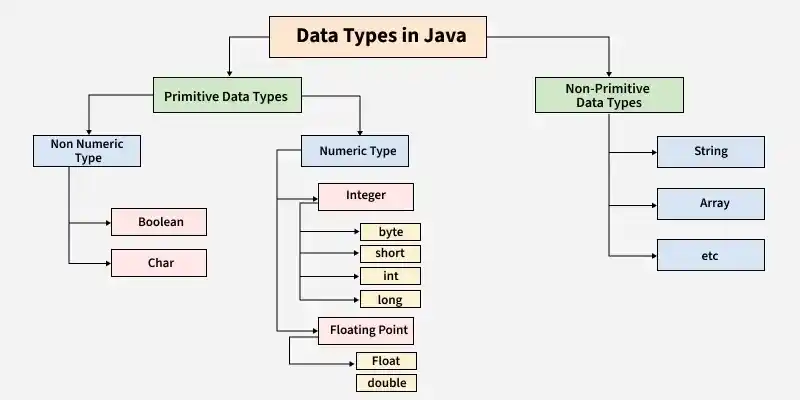

# 16. Explain different data types in Java.

There are 2 types of data types in Java as mentioned below:

**Primitive Data Type:** Primitive data are single values with no special capabilities. There are 8 primitive data types:

- **boolean**: stores value true or false
- **byte**: stores an 8-bit signed two's complement integer
- **char**: stores a single 16-bit Unicode character
- **short**: stores a 16-bit signed two’s complement integer
- **int**: stores a 32-bit signed two’s complement integer
- **long**: stores a 64-bit two’s complement integer
- **float**: stores a single-precision 32-bit IEEE 754 floating-point
- **double**: stores a double-precision 64-bit IEEE 754 floating-point

**Non-Primitive Data Type:** Reference Data types will contain a memory address of the variable's values because it is not able to directly store the values in the memory. Types of Non-Primitive are mentioned below:

- **String:** Stores a sequence of characters.
- **Array:** Stores multiple values of the same type.
- **Class:** Blueprint for creating objects.
- **Object:** Instance of a class.
- **Interface:** Defines a contract that classes can implement.

---

[← Back to Easy index](README.md) · Source: [GeeksforGeeks](https://www.geeksforgeeks.org/java/java-interview-questions/#16-explain-different-data-types-in-java)
