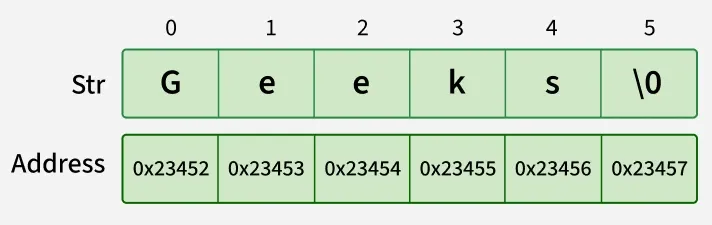

# 46. What is String in Java?

A String in Java is an object that represents a sequence of characters. It is used to store and manipulate text data.

- In Java, String is a class (from java.lang package), not a primitive data type.
- Strings are immutable, meaning their value cannot be changed after creation.
- Java provides a String pool to optimize memory usage by reusing string literals.

---

[← Back to Easy index](README.md) · Source: [GeeksforGeeks](https://www.geeksforgeeks.org/java/java-interview-questions/#46-what-is-string-in-java)
