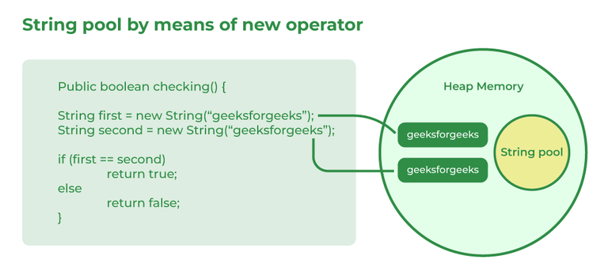

# 51. How is the creation of a String using new() different from that of a literal?

A [String](https://www.geeksforgeeks.org/java/strings-in-java/) can be created either using a string literal or the new keyword. Both create String objects, but they differ in memory allocation and reuse.

- A string literal (e.g., String s = "Java";) is stored in the String Constant Pool and reused if the same value already exists.
- A String created using new (e.g., String s = new String("Java");) always creates a new object in heap memory, even if an identical string exists in the pool.
- String literals are more memory-efficient, while new guarantees a separate String object.

---

[← Back to Easy index](README.md) · Source: [GeeksforGeeks](https://www.geeksforgeeks.org/java/java-interview-questions/#51-how-is-the-creation-of-a-string-using-new-different-from-that-of-a-literal)
