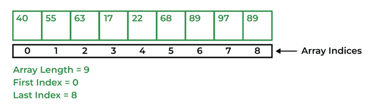

# 54. What are the types of an array?

There are two types of arrays i.e., Primitive arrays and References Arrays.

**1. Single-Dimensional Arrays:** Arrays that have only one dimension i.e., an array of integers or an array of strings are known as single-dimensional arrays.

**Syntax:**

> data_type[] Array_Name = new data_type[ArraySize];

**2.** [**Multi-Dimensional Arrays**](https://www.geeksforgeeks.org/java/multidimensional-arrays-in-java/)**:** Arrays that have two or more dimensions such as two-dimensional or three-dimensional arrays.

**Syntax:**

> data_type[dim1][dim2]...[dimN] array_name = new data_type[size1][size2]...[sizeN];

---

[← Back to Easy index](README.md) · Source: [GeeksforGeeks](https://www.geeksforgeeks.org/java/java-interview-questions/#54-what-are-the-types-of-an-array)
