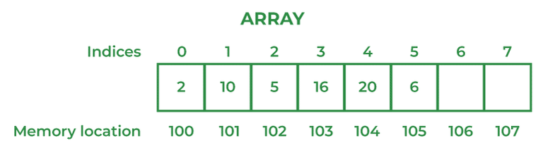

# 60. What are the advantages and disadvantages of an array?

An array is a simple and efficient data structure used to store multiple elements of the same data type. It provides fast access to elements but has some limitations regarding size and flexibility.

#### The advantages of Arrays are

- Arrays provide fast access to elements using their index.
- They store elements in contiguous memory locations, improving performance.
- Arrays are easy to use and suitable for storing large amounts of similar data.

#### Disadvantages of Arrays are

- Arrays have a fixed size, which cannot be changed after creation.
- They can store only homogeneous (same type) elements.
- Inserting or deleting elements can be inefficient because existing elements may need to be shifted.

---

[← Back to Easy index](README.md) · Source: [GeeksforGeeks](https://www.geeksforgeeks.org/java/java-interview-questions/#60-what-are-the-advantages-and-disadvantages-of-an-array)
