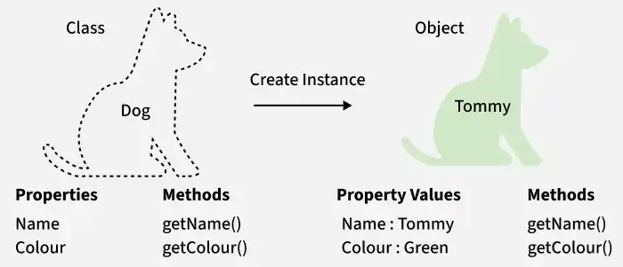

# 65. What are Classes in Java?

A [class in Java](https://www.geeksforgeeks.org/java/classes-objects-java/) is a blueprint or template used to create objects. It defines the properties (variables) and behaviors (methods) that objects of that class will have.

- A class contains fields (data members) and methods (member functions) that describe an object's state and behavior.
- Objects are created from a class using the new keyword.
- Classes help achieve encapsulation, reusability, and modularity in object-oriented programming.

For Example, Dog is a class, Tommy is an object of that class.

---

[← Back to Easy index](README.md) · Source: [GeeksforGeeks](https://www.geeksforgeeks.org/java/java-interview-questions/#65-what-are-classes-in-java)
