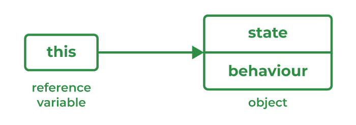

# 67. What is this keyword in Java?

The [this keyword](https://www.geeksforgeeks.org/java/java-this-keyword/) is a reference variable that refers to the current object of a class. It is used to access the current object's variables, methods, and constructors.

- It is commonly used to distinguish instance variables from local variables when they have the same name.
- It can be used to invoke the current class method or constructor.

---

[← Back to Easy index](README.md) · Source: [GeeksforGeeks](https://www.geeksforgeeks.org/java/java-interview-questions/#67-what-is-this-keyword-in-java)
