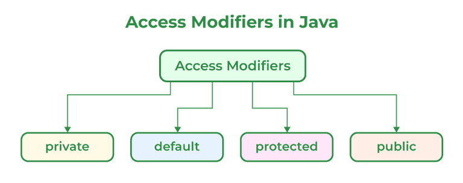

# 68. What are Access Specifiers and their types in Java?

[Access specifiers](https://www.geeksforgeeks.org/java/access-modifiers-java/) (also called access modifiers) are keywords used to control the visibility and accessibility of classes, variables, methods, and constructors in Java. They help implement encapsulation and protect data from unauthorized access.

- **public:** Accessible from anywhere in the program, including different packages.
- **protected**: Accessible within the same package and by subclasses in other packages.
- **default (package-private):** Accessible only within the same package. No keyword is used.
- **private:** Accessible only within the same class.

---

[← Back to Easy index](README.md) · Source: [GeeksforGeeks](https://www.geeksforgeeks.org/java/java-interview-questions/#68-what-are-brief-access-specifiers-and-types-of-access-specifiers)
