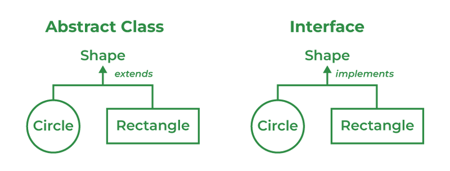

# 84. What are the differences between abstract class and interface?

| Abstract Class | Interface Class |
| --- | --- |
| Both abstract and non-abstract methods may be found in an abstract class. | The interface contains only abstract methods. |
| Abstract Class supports Final methods. | The interface class does not support Final methods. |
| Multiple inheritance is not supported by the Abstract class. | Multiple inheritances is supported by Interface Class. |
| Abstract Keyword is used to declare Abstract class. | Interface Keyword is used to declare the interface class. |
| **extend** keyword is used to extend an Abstract Class. | **implements** keyword is used to implement the interface. |
| Abstract Class has members like protected, private, etc. | All class members are public by default. |

---

[← Back to Easy index](README.md) · Source: [GeeksforGeeks](https://www.geeksforgeeks.org/java/java-interview-questions/#84-what-are-the-differences-between-abstract-class-and-interface)
