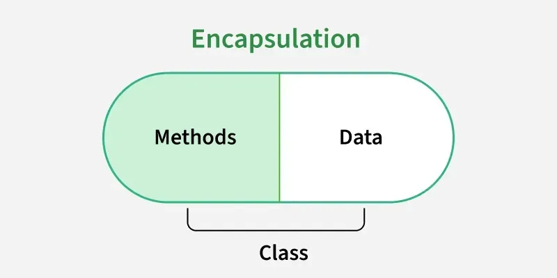

# 85. What do you mean by data encapsulation?

Data [encapsulation](https://www.geeksforgeeks.org/java/encapsulation-in-java/) is the process of wrapping data (variables) and the methods that operate on that data into a single unit called a class. It also restricts direct access to the data by using access modifiers.

- Encapsulation helps protect data from unauthorized access and modification.
- It is typically achieved by declaring variables as private and providing public getter and setter methods to access them.
- Encapsulation improves security, maintainability, and code reusability.

---

[← Back to Easy index](README.md) · Source: [GeeksforGeeks](https://www.geeksforgeeks.org/java/java-interview-questions/#85-what-do-you-mean-by-data-encapsulation)
