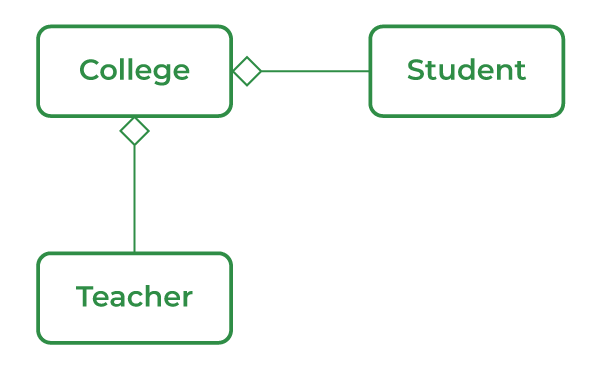

# 88. What do you mean by aggregation?

Aggregation is a special form of association in Java that represents a "has-a" relationship between two classes. In aggregation, one class contains a reference to another class, but both objects can exist independently of each other.

- Aggregation represents a weak relationship where the child object can exist even if the parent object is destroyed.
- It models real-world relationships such as College has Student or Teacher.

---

[← Back to Easy index](README.md) · Source: [GeeksforGeeks](https://www.geeksforgeeks.org/java/java-interview-questions/#88-what-do-you-mean-by-aggregation)
