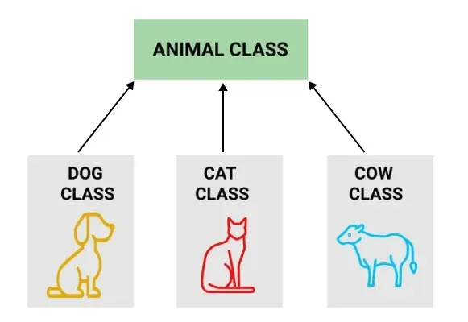

# 90. Define Inheritance.

[Inheritance](https://www.geeksforgeeks.org/java/inheritance-in-java/) is an Object-Oriented Programming (OOP) concept that allows one class to acquire the properties and behaviors of another class. It promotes code reusability and establishes an IS-A relationship between classes.

- Inheritance allows a child class (subclass) to inherit fields and methods from a parent class (superclass).
- It helps reduce code duplication and improves maintainability.
- In Java, inheritance is achieved using the extends keyword.

**Example:** A Dog class can inherit the properties and behaviors of an Animal class because a Dog IS-A Animal.

---

[← Back to Easy index](README.md) · Source: [GeeksforGeeks](https://www.geeksforgeeks.org/java/java-interview-questions/#90-define-inheritance)
