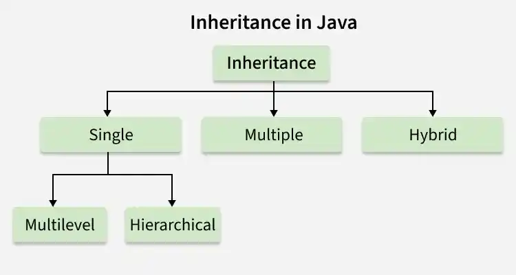

# 91. What are the different types of inheritance in Java?

Inheritance is the method by which the Child class can inherit the features of the Super or Parent class. In Java, Inheritance is of four types:

- **Single Inheritance:** When a child or subclass extends only one superclass, it is known to be single inheritance. Single-parent class properties are passed down to the child class.
- **Multilevel Inheritance:** When a child or subclass extends any other subclass a hierarchy of inheritance is created which is known as multilevel inheritance. In other words, one subclass becomes the parent class of another.
- **Hierarchical Inheritance:** When multiple subclasses derive from the same parent class is known as Hierarchical Inheritance. In other words, a class that has a single parent has many subclasses.
- **Multiple Inheritance:** When a child class inherits from multiple parent classes is known as Multiple Inheritance. In Java, it only supports multiple inheritance of interfaces, not classes.

---

[← Back to Easy index](README.md) · Source: [GeeksforGeeks](https://www.geeksforgeeks.org/java/java-interview-questions/#91-what-are-the-different-types-of-inheritance-in-java)
