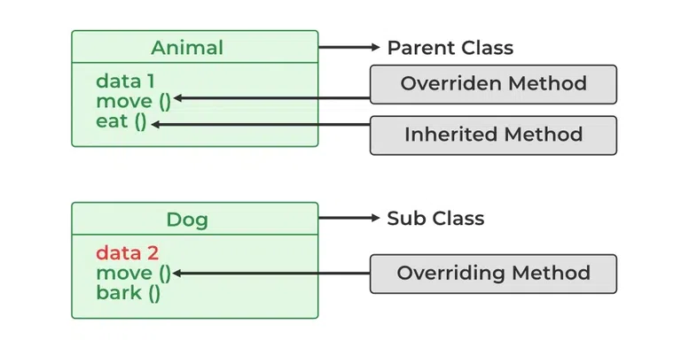

# 103. What is method overriding?

[Method Overriding](https://www.geeksforgeeks.org/java/overriding-in-java/) is a feature in which a child class provides its own implementation of a method that is already defined in the parent class. This allows the child class to modify or extend the behavior of the inherited method.

- Requires Inheritance between parent and child classes.
- The method in both classes must have the same name, parameters, and return type.
- Used to achieve Runtime Polymorphism in Java.

---

[← Back to Easy index](README.md) · Source: [GeeksforGeeks](https://www.geeksforgeeks.org/java/java-interview-questions/#103-what-is-method-overriding)
