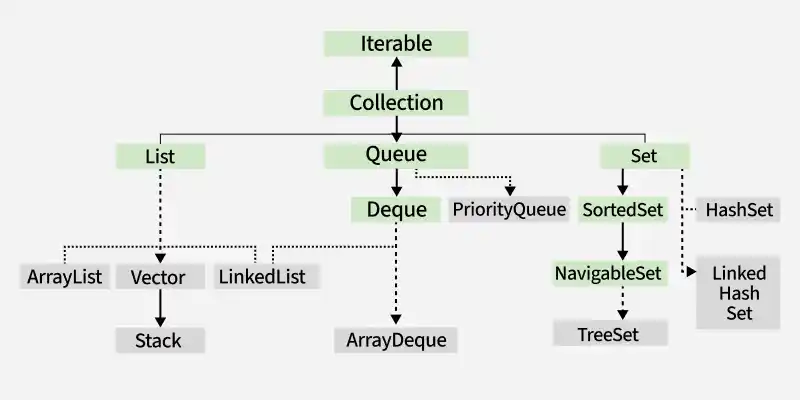

# 118. Explain various interfaces used in the Collection framework.

The [Collection Framework](https://www.geeksforgeeks.org/java/java-collection-tutorial/) provides several interfaces that define different ways of storing and managing data. Each interface serves a specific purpose and has multiple implementation classes.

- **List:** Stores elements in insertion order and allows duplicate values (e.g., ArrayList, LinkedList).
- **Set:** Stores unique elements and does not allow duplicates (e.g., HashSet, LinkedHashSet, TreeSet).
- **Queue:** Stores elements for processing in a specific order, typically FIFO (e.g., PriorityQueue, ArrayDeque).
- **Map:** Stores data as key-value pairs, where each key is unique (e.g., HashMap, LinkedHashMap, TreeMap).

---

[← Back to Easy index](README.md) · Source: [GeeksforGeeks](https://www.geeksforgeeks.org/java/java-interview-questions/#118-explain-various-interfaces-used-in-the-collection-framework)
