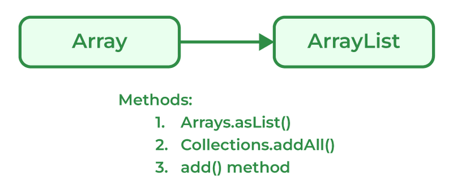
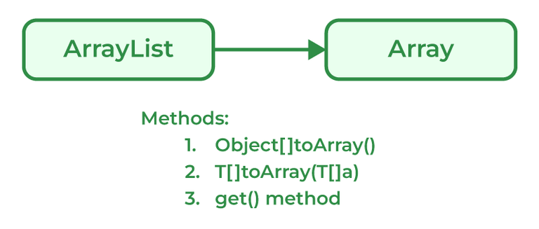

# 123. Explain the method to convert ArrayList to Array and Array to ArrayList.

#### Conversion of List to ArrayList

There are multiple methods to convert List into ArrayList



Programmers can convert an Array to ArrayList using asList() method of the Arrays class. It is a static method of the Arrays class that accepts the List object.

#### Syntax

> Arrays.asList(item)

```java
// Java program to demonstrate conversion of
// Array to ArrayList of fixed-size.
import java.util.*;
// Driver Class
class GFG {
    // Main Function
    public static void main(String[] args)
    {
        String[] temp = { "Abc", "Def", "Ghi", "Jkl" };
        // Conversion of array to ArrayList
        // using Arrays.asList
        List conv = Arrays.asList(temp);
        System.out.println(conv);
    }
}
```

**Output**

```text
[Abc, Def, Ghi, Jkl]
```

#### Conversion of ArrayList to Array



Java programmers can convert ArrayList to

**Syntax:**

> List_object.toArray(new String[List_object.size()])

```java
import java.util.List;
import java.util.ArrayList;

// Driver Class
class GFG {
    // Main Function
    public static void main(String[] args) {
        // List declared
        List<Integer> arr = new ArrayList<>();
        arr.add(1);
        arr.add(2);
        arr.add(3);
        arr.add(2);
        arr.add(1);

        // Conversion
        Object[] objects = arr.toArray();

        // Printing array of objects
        for (Object obj : objects)
            System.out.print(obj + " ");
    }
}
```

**Output**

```text
1 2 3 2 1
```

---

[← Back to Easy index](README.md) · Source: [GeeksforGeeks](https://www.geeksforgeeks.org/java/java-interview-questions/#123-explain-the-method-to-convert-arraylist-to-array-and-array-to-arraylist)
