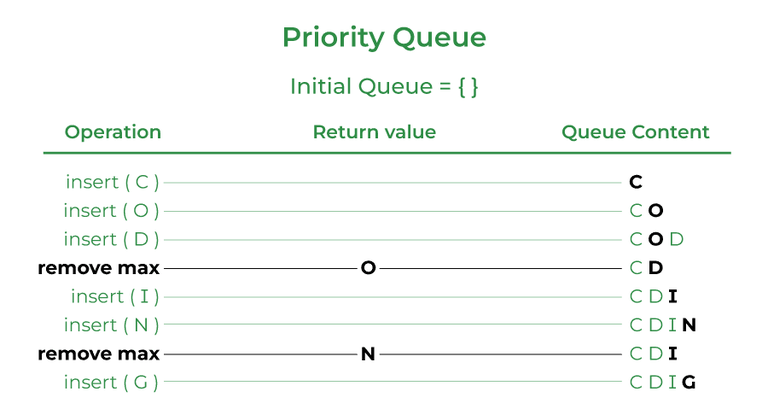

# 127. What is a priority queue in Java?



A priority queue is an abstract data type similar to a regular queue or stack data structure. Elements stored in elements are depending upon the priority defined from low to high. The PriorityQueue is based on the priority heap.

```java
import java.util.*;

class PriorityQueueDemo {
    // Main Method
    public static void main(String args[]) {
        // Creating empty priority queue
        PriorityQueue<Integer> var1 = new PriorityQueue<Integer>();
        // Adding items to the pQueue using add()
        var1.add(10);
        var1.add(20);
        var1.add(15);
        // Printing the top element of PriorityQueue
        System.out.println(var1.peek());
    }
}
```

**Output**

```text
10
```

---

[← Back to Easy index](README.md) · Source: [GeeksforGeeks](https://www.geeksforgeeks.org/java/java-interview-questions/#127-what-is-a-priority-queue-in-java)
