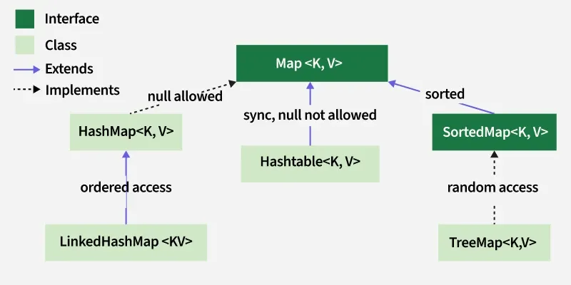

# 133. What is a Map interface in Java?

A [Map](https://www.geeksforgeeks.org/java/map-interface-in-java/) is an interface in the Java Collections Framework that stores data in the form of key-value pairs, where each key is unique and is used to retrieve its corresponding value.

- Stores elements as key-value pairs.
- Does not allow duplicate keys, but duplicate values are permitted.
- Common implementations include HashMap, LinkedHashMap, and TreeMap.

**Example:** A Map can be used to store employee IDs as keys and employee names as values.

---

[← Back to Easy index](README.md) · Source: [GeeksforGeeks](https://www.geeksforgeeks.org/java/java-interview-questions/#133-what-is-a-map-interface-in-java)
