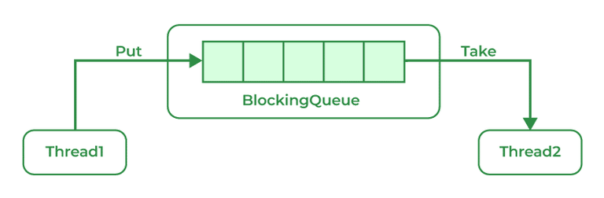

# 136. What is BlockingQueue?

A blocking queue is a Queue that supports the operations that wait for the queue to become non-empty while retrieving and removing the element, and wait for space to become available in the queue while adding the element.

**Syntax:**

> public interface BlockingQueue\<E> extends Queue\<E>

**Parameters:** E is the type of elements stored in the Collection

---

[← Back to Easy index](README.md) · Source: [GeeksforGeeks](https://www.geeksforgeeks.org/java/java-interview-questions/#136-what-is-blockingqueue)
