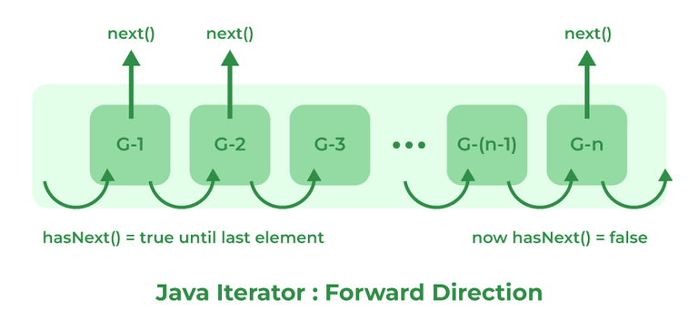

# 139. What is an Iterator?

An Iterator is an interface in the Java Collections Framework that is used to traverse or iterate through the elements of a collection one by one. It provides a uniform way to access collection elements without exposing the underlying data structure.

- Used to traverse collections such as ArrayList, HashSet, and LinkedList.
- Provides methods like hasNext(), next(), and remove().
- Allows safe removal of elements while iterating through a collection.

---

[← Back to Easy index](README.md) · Source: [GeeksforGeeks](https://www.geeksforgeeks.org/java/java-interview-questions/#139-what-is-an-iterator)
