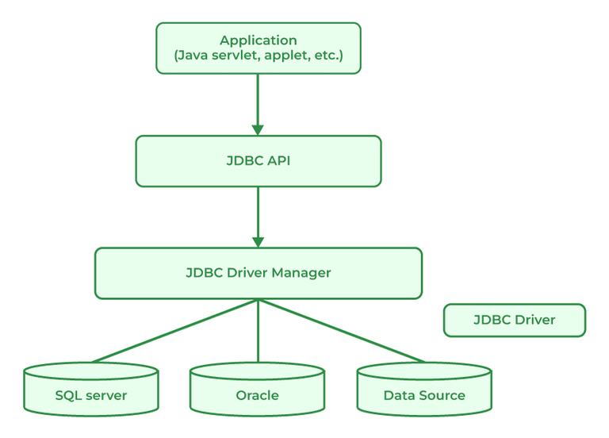

# 189. What is JDBC?

[JDBC](https://www.geeksforgeeks.org/java/introduction-to-jdbc/) standard API is used to link Java applications and relational databases. It provides a collection of classes and interfaces that let programmers to use the Java programming language to communicate with the database. The classes and interface of JDBC allow the application to send requests which are made by users to the specified database. There are generally four components of JDBC by which it interacts with the database:

- JDBC API
- JDBC Driver manager
- JDBC Test Suite
- JDBC-ODBC Bridge Drivers

---

[← Back to Hard index](README.md) · Source: [GeeksforGeeks](https://www.geeksforgeeks.org/java/java-interview-questions/#189-what-is-jdbc)
