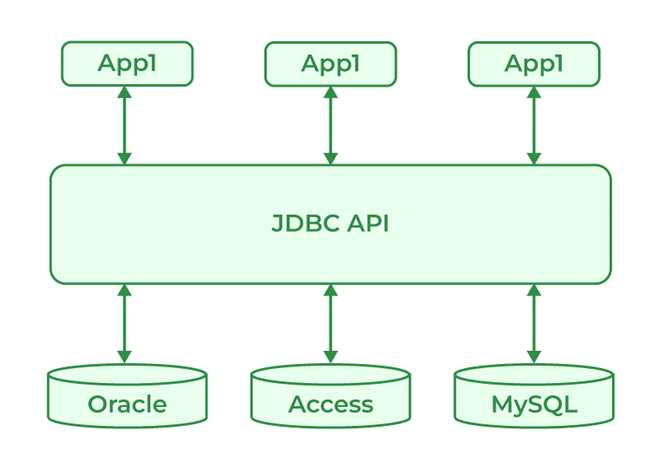

# 190. What is JDBC Driver?

[JDBC Driver](https://www.geeksforgeeks.org/java/jdbc-drivers/) is a software component that is used to enable a Java application to interact with the database. JDBC provides the implementation of the JDBC API for a specific database management system, which allows it to connect the database, execute SQL statements and retrieve data. There are four types of JDBC drivers:

- JDBC-ODBC Bridge driver
- Native-API driver
- Network Protocol driver
- Thin driver

---

[← Back to Hard index](README.md) · Source: [GeeksforGeeks](https://www.geeksforgeeks.org/java/java-interview-questions/#190-what-is-jdbc-driver)
