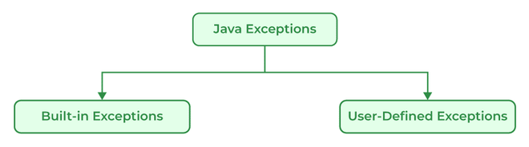

# 153. How many types of exceptions can occur in a Java program?

**There are generally two types of exceptions in Java:**

**1. Built-in Exceptions:** Built-in exceptions in Java are provided by the Java Libraries. These exceptions can be further divided into two subcategories i.e., checked and unchecked Exceptions. Below are some of the built-in exceptions in Java:

- ArrayIndexOutOfBoundsExceptions
- ClassNotFoundException
- FileNotFoundException
- IOException
- NullPointerException

**2. User-Defined Exceptions:** User-defined exceptions are defined by the programmers themselves to handle some specific situations or errors which are not covered by built-in exceptions. To define user-defined exceptions a new class that extends the appropriate exception class must be defined. User-defined Exceptions in Java are used when the built-in exceptions are in Java.

---

[← Back to Medium index](README.md) · Source: [GeeksforGeeks](https://www.geeksforgeeks.org/java/java-interview-questions/#153-how-many-types-of-exceptions-can-occur-in-a-java-program)
