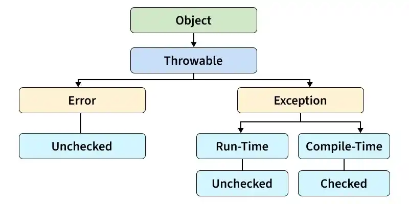

# 155. Explain the hierarchy of Java Exception classes.

The Java Exception hierarchy is a class structure that organizes all exceptions and errors under the Throwable class. It helps Java classify and handle different types of runtime problems effectively.

- Throwable is the root class of the exception hierarchy.
- It has two main subclasses: Exception and Error.
- Exception includes checked exceptions and unchecked exceptions (RuntimeException and its subclasses).

---

[← Back to Medium index](README.md) · Source: [GeeksforGeeks](https://www.geeksforgeeks.org/java/java-interview-questions/#155-explain-the-hierarchy-of-java-exception-classes)
