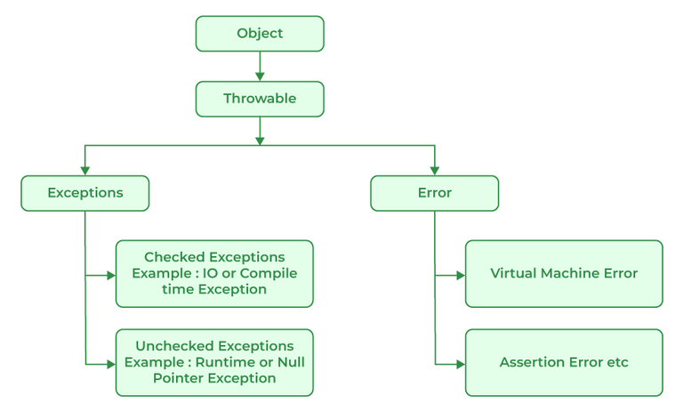

# 160. What is the base class for Error and Exception?

Error is an illegal operation performed by the user which causes abnormality in the program. Exceptions are the unexpected events or conditions that comes while running the program, exception disrupts the normal flow of the program’s instructions.

Errors and Exceptions both have a common parent class which is java.lang.Throwable class.

---

[← Back to Medium index](README.md) · Source: [GeeksforGeeks](https://www.geeksforgeeks.org/java/java-interview-questions/#160-what-is-the-base-class-for-error-and-exception)
