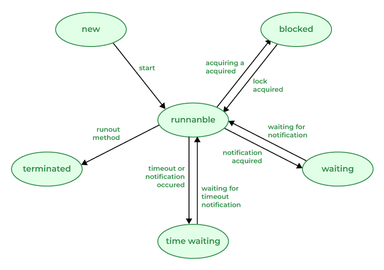

# 175. Describe the life cycle of the thread?

A [thread](https://www.geeksforgeeks.org/java/multithreading-in-java/) in Java at any point in time exists in any one of the following states. A thread lies only in one of the shown states at any instant:

- **New:** The thread has been created but has not yet started.
- **Runnable:** The thread is running, executing its task, or is ready to run if there are no other higher-priority threads.
- **Blocked:** The thread is temporarily suspended, waiting for a resource or an event.
- **Waiting:** The thread is waiting for another thread to perform a task or for a specified amount of time to elapse.
- **Terminated:** The thread has completed its task or been terminated by another thread.

Thread Life Cycle

---

[← Back to Medium index](README.md) · Source: [GeeksforGeeks](https://www.geeksforgeeks.org/java/java-interview-questions/#175-describe-the-life-cycle-of-the-thread)
