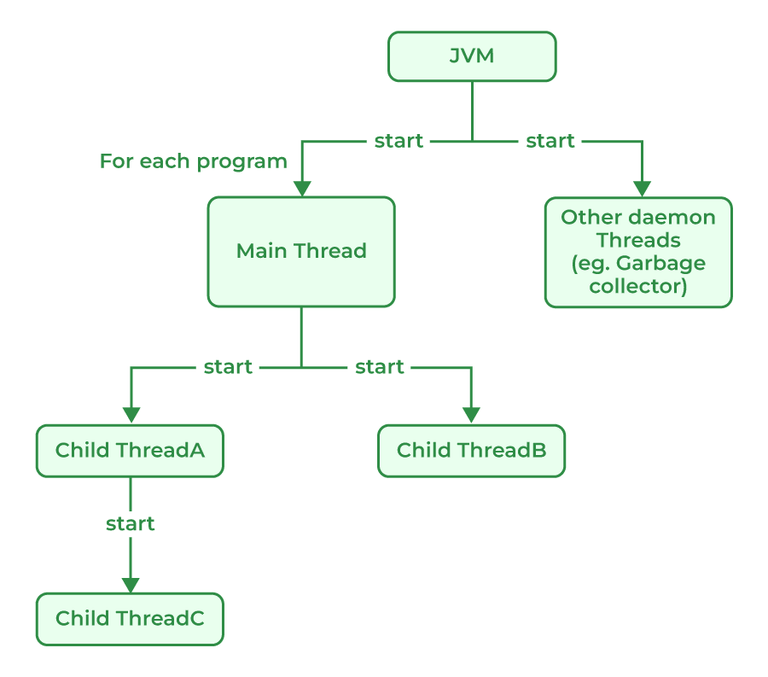

# 177. Explain the main thread under Thread class execution.

Java provides built-in support for multithreaded programming. The main thread is considered the parent thread of all the other threads that are created during the program execution. The main thread is automatically created when the program starts running. This thread executes the main method of the program. It is responsible for executing the main logic of the Java program as well as handling the user input operations. The main thread serves as the base thread from which all other child threads are spawned.

---

[← Back to Medium index](README.md) · Source: [GeeksforGeeks](https://www.geeksforgeeks.org/java/java-interview-questions/#177-explain-the-main-thread-under-thread-class-execution)
