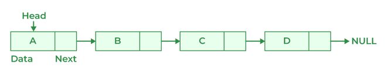
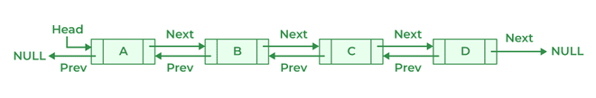

# 202. Differentiate between the Singly Linked List and Doubly Linked List.

| Singly Linked List | Doubly Linked List |
| --- | --- |
| Singly Linked List contain only two segments i.e, Data and Link. | Doubly Linked List contains three segments i.e, Data, and two pointers. |
| Traversal in a singly linked list is possible in only a forward direction. | Traversal in a doubly linked list is only possible in both directions forward as well as backward. |
| It uses less memory as every single node has only one pointer. | It requires more memory than a singly linked list as each node has two pointers. |
| Easy to use and insert nodes at the beginning of the list. | Slightly more complex to use and easy to insert at the end of the list. |
| Insertion and deletion at the head take O(1), but at any other position, they require traversal, making them O(n). | Insertion and deletion at the start or end take O(1) (if head and tail pointers are maintained). However, operations at arbitrary positions require O(n) time due to traversal. |
|  |  |

---

[← Back to Medium index](README.md) · Source: [GeeksforGeeks](https://www.geeksforgeeks.org/java/java-interview-questions/#202-differentiate-between-the-singly-linked-list-and-doubly-linked-list)
