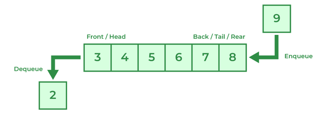
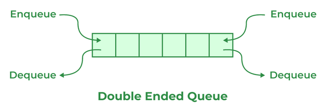

# 205. Differentiate between Queue and Deque.

| Queue | Deque |
| --- | --- |
| The queue is a linear Data structure that is used to store a collection of elements. | Deque also known as a Double-ended queue is also a linear data structure that stores a collection of elements with operations to remove and add from both ends. |
| Elements in the queue can only be inserted at the end of the data structure. | Elements can be inserted from both ends of the data structure. |
| Queue can be implemented using Array or Linked List. | Dequeue can be implemented using Circular Array or Doubly Linked List. |
| Queues are generally used to implement a waiting list or task queue. | Deque is used to implement a stack or dequeuing elements from both ends. |
|  |  |

---

[← Back to Medium index](README.md) · Source: [GeeksforGeeks](https://www.geeksforgeeks.org/java/java-interview-questions/#205-differentiate-between-queue-and-deque)
